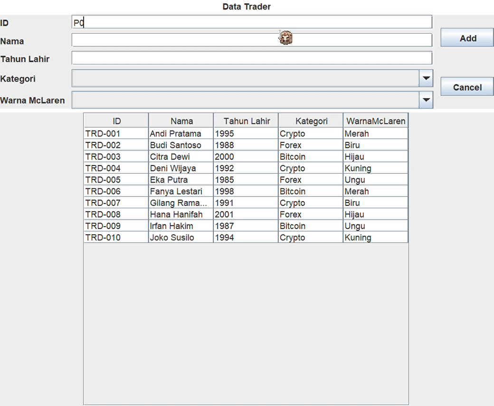
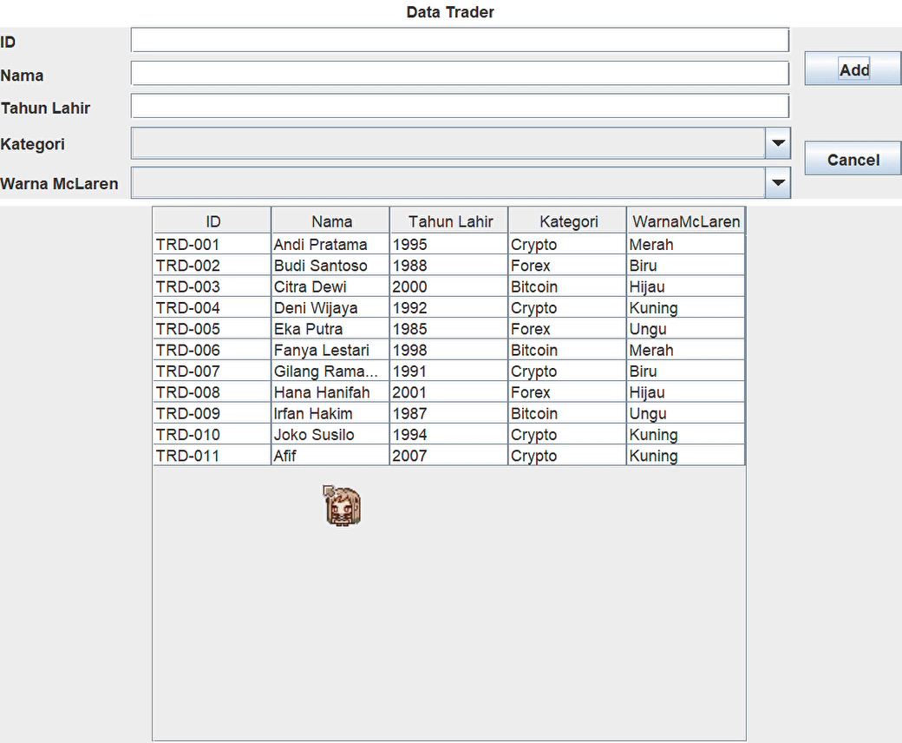
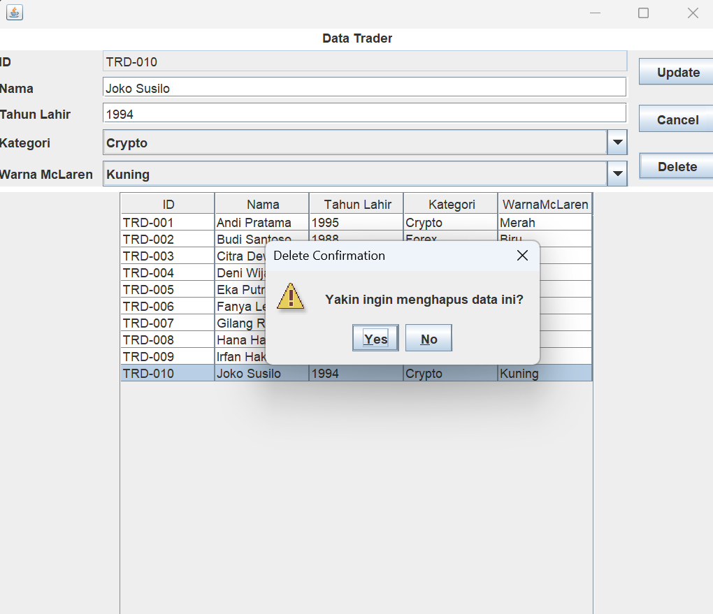
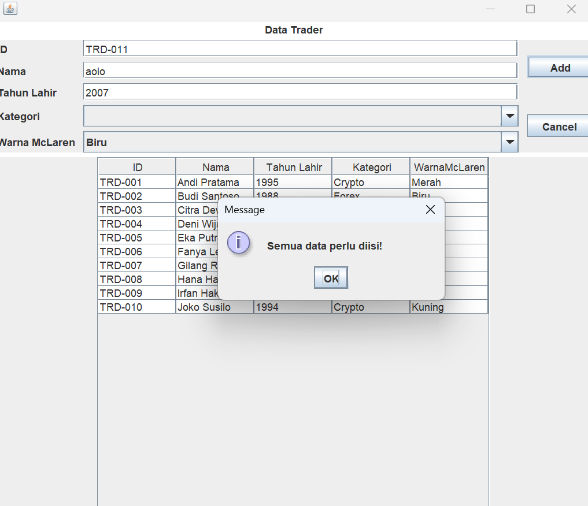

<<<<<<< HEAD
# TP4DPBO2526C1

## Janji
Saya Afif Fadilah Rahman dengan NIM 2508287 mengerjakan TP 4 dalam mata kuliah Desain Pemrograman Berbasis Objek untuk keberkahan-Nya maka saya tidak melakukan kecurangan seperti yang telah dispesifikasikan. Aamiin

## Desain/fungsi program
Program memiliki tema data trader yang memiliki attribut kategori berupa kategori jenis alat tukar yang digunakan oleh trader tersbeut serta attribut warnaMcLaren yaitu salah satu asset kekayaan trader tersebut.\
Program menyediakan form inputan masing-masing attribut serta tombol untuk memodifikasi inputan atau data yang sudah ada di tabel.

## Penjelasan alur
Desain swing GUI program memiliki 3 komponen text field dan 2 komponen combo box sebagai komponen penerima inputan user. Kemudian ada button add, cancel, dan delete yang terletak di kanan GUI. Tombol add untuk mengirim data inputan dari GUI ke program melalui button event listener dan insert data method. Tombol cancel untuk reset form inputan. Serta tombol delete untuk menghapus data di tabel.
Pada bagian bawah GUI terdapat tabel data yang berisi data dummy dan data yang berhasil diinput oleh user.\
\
Pada program source code terdapat 2 file yaitu 1 file Person sebagai class person dan 1 file Menu sebagai class menu GUI.

## Dokumentasi

### Menambahkan data

### Update data

### Delete data

### Error Handle

=======
# TP5DPBO2526C1
>>>>>>> 486fa22a0e59e417f092341816453641a37d5b94
